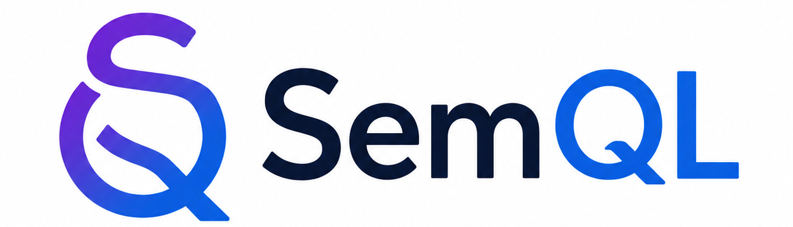
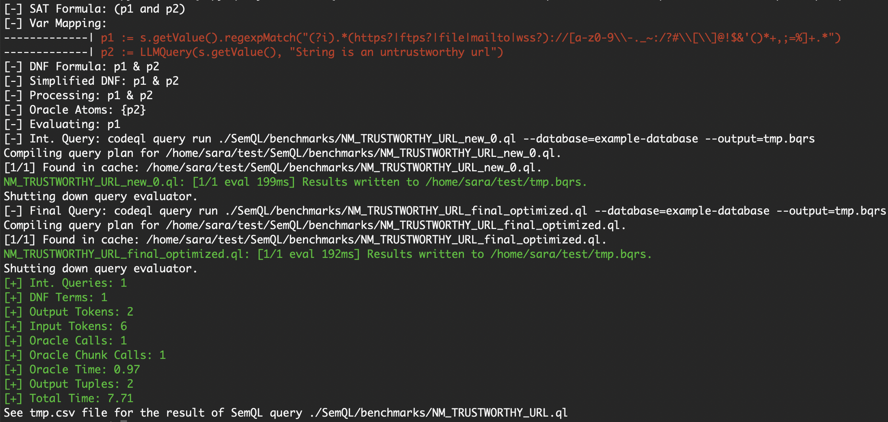

<div align="left">
  <a href="https://github.com/SaraBaradaran/SemQL">
    
  </a>
</div>
<!-- An extension of CodeQL language -->

## Download and Install CodeQL
```
wget https://github.com/github/codeql-action/releases/download/codeql-bundle-v2.17.0/codeql-bundle-linux64.tar.gz
tar -xzf codeql-bundle-linux64.tar.gz 
export PATH=$PATH:/path/to/codeql
codeql resolve qlpacks
```

To run the benchmakrs on the subject program which we used in our evaluation, you simply need to do the following steps:

###### Download the subject codebases from Google Drive at [link](https://drive.google.com/drive/folders/1ydc8Pmjb6uU8nygd6BXzDQGLCTCAZmr5?usp=sharing)
###### Create the dataset of facts
```
codeql database create databases/example-database --language=java --source-root=path/to/codebase --build-mode=none
```
###### Run an Example SemQL query

```
python3 SemQL3.py --query ./queries/assertion.ql --database databases/example-database
```

<div align="center">
  <a href="https://github.com/SaraBaradaran/SemQL">
    
  </a>
</div>
