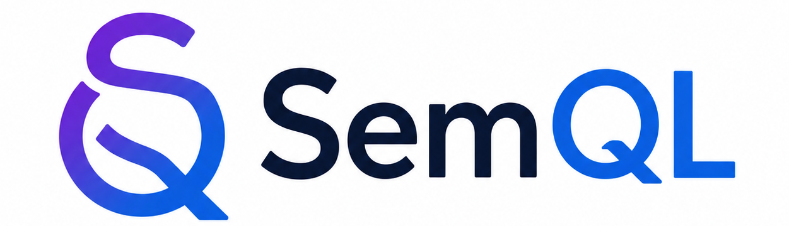
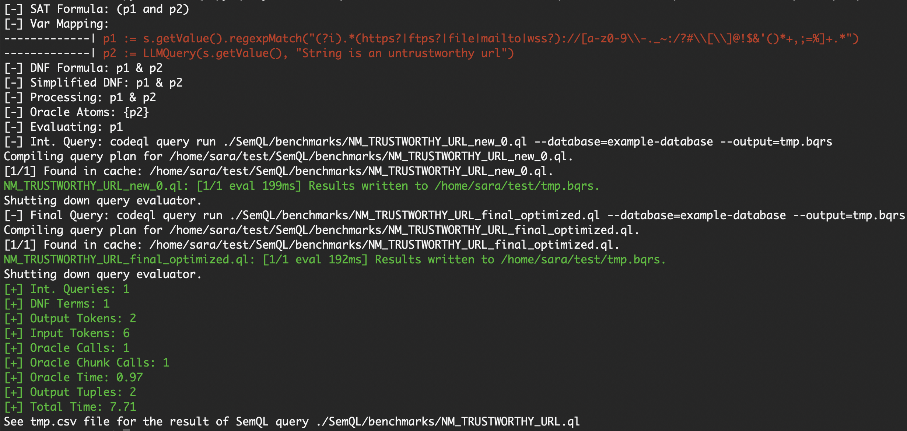

<div align="left">
  <a href="https://github.com/SaraBaradaran/SemQL">
    
  </a>
</div>
<!-- An extension of CodeQL language -->

For more information, see our SOAP 2026 paper ["LLM-Integrated Declarative Program Analysis"](https://doi.org/10.1145/3814987.3814993).
If you use this tool in your research, please cite our paper as follows:
```
@inproceedings{10.1145/3814987.3814993,
author = {Baradaran, Sara and Nazari, Amirmohammad and Raghothaman, Mukund},
title = {LLM-Integrated Declarative Program Analysis},
year = {2026},
isbn = {9798400727092},
publisher = {Association for Computing Machinery},
doi = {10.1145/3814987.3814993},
booktitle = {Proceedings of the 15th ACM SIGPLAN International Workshop on the State Of the Art in Program Analysis},
pages = {41–47},
numpages = {7},
location = {Boulder, CO, USA},
series = {SOAP '26}
}
```

## Download and Install CodeQL
```
wget https://github.com/github/codeql-action/releases/download/codeql-bundle-v2.17.0/codeql-bundle-linux64.tar.gz
tar -xzf codeql-bundle-linux64.tar.gz 
export PATH=$PATH:/path/to/codeql
codeql resolve qlpacks
```

To run the benchmakrs on the SpotBugs code base, you simply need to do the following steps
#### Clone the Codebase
```
git clone https://github.com/spotbugs/spotbugs
```
#### Create The Dataset of Facts
```
codeql database create example-database --language=java --source-root=spotbugs/spotbugsTestCases/src/java --build-mode=none
```
#### Run An Example SemQL Query

```
python3 SemQL.py query run ./benchmarks/NM_TRUSTWORTHY_URL.ql --database=example-database --output=tmp.bqrs
```

<div align="center">
  <a href="https://github.com/SaraBaradaran/SemQL">
    
  </a>
</div>
